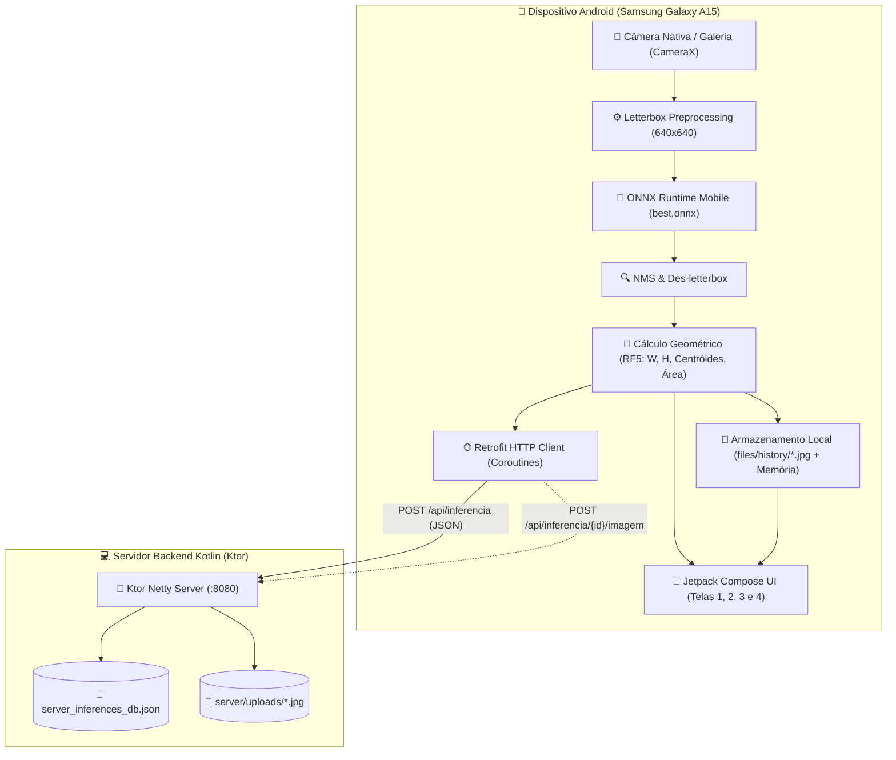

# Explicação Técnica e Arquitetural do Sistema Mobile
**Projeto:** Leitor e Auditor de Documentos Assinados  
**Instituição:** Universidade de Rio Verde — UniRV  
**Disciplina:** Desenvolvimento de Software para Dispositivos Móveis (N2)  
**Professor:** Me. Sergio Souza Novak  
**Alunos:** Kauan Almeida e Kawã Santos  

---

## 1. Visão Geral da Arquitetura

O sistema foi construído seguindo o paradigma **Full-Stack Mobile em Kotlin**. A solução resolve o problema de validação de assinaturas em contratos e folhas físicas de forma **100% offline no celular**, transmitindo os metadados e evidências para um servidor corporativo central de auditoria.

### Diagrama de Fluxo de Dados e Componentes



---

## 2. Tecnologias Utilizadas e Como Funcionam

### 2.1. Kotlin 2.4 (Linguagem Unificada Full-Stack)
O projeto utiliza **100% Kotlin** do front-end móvel ao back-end do servidor:
- **Segurança contra nulos (*Null Safety*)**: Elimina falhas comuns de execução (`NullPointerException`).
- **Coroutines & StateFlow**: Gerenciam todo o assincronismo (inferência de rede neural, operações de entrada/saída de disco e requisições HTTP) sem congelar a interface visual do celular.

### 2.2. Jetpack Compose & Material 3 (Interface Declarativa)
Diferente do sistema antigo de XML Views, o Jetpack Compose descreve a interface como funções reativas de estado:
- **Tema Light Mode Obrigatório (*Corporate Trust*)**: Criado em [Theme.kt](file:///c:/Users/kauan/Desktop/leitor-de-documentos-assinados/app/src/main/java/com/unirv/assinaturas/theme/Theme.kt), utiliza fundo gelo (`#F8FAFC`), cartões brancos com sombras sutis, botões em Azul Profissional (`#2563EB`) e sinalizações de sucesso em Verde Esmeralda (`#10B981`).
- **Canvas Personalizado**: O componente [AnnotatedImageView.kt](file:///c:/Users/kauan/Desktop/leitor-de-documentos-assinados/app/src/main/java/com/unirv/assinaturas/ui/components/AnnotatedImageView.kt) projeta dinamicamente as caixas delimitadoras sobre a imagem, calculando o fator de escala real (*Aspect Fit*) e desenhando a mira do centróide.

### 2.3. Inteligência Artificial On-Device: YOLOv8s & ONNX Runtime Mobile
A inferência de visão computacional ocorre **dentro do chip do celular**, sem necessidade de enviar a foto para processamento em servidores de nuvem:
1. **O Modelo Treinado**: O modelo YOLOv8s treinado pelo grupo no Roboflow para a classe `signature` foi exportado de PyTorch (`.pt`) para o formato interoperável aberto [best.onnx](file:///c:/Users/kauan/Desktop/leitor-de-documentos-assinados/model/best.onnx), otimizado via `onnxslim` para consumo reduzido de memória e bateria.
2. **Motor de Execução**: Utiliza a biblioteca oficial da Microsoft `com.microsoft.onnxruntime:onnxruntime-android`. O modelo fica embarcado na pasta de assets do aplicativo (`app/src/main/assets/best.onnx`).
3. **Pré-processamento com Letterboxing**:
   - Fotos tiradas por smartphones possuem resolução vertical (ex: 1080×1920, proporção 9:16).
   - Se a foto fosse simplesmente esmagada para um quadrado de $640 \times 640$, a caligrafia da assinatura ficaria comprimida e deformada, fazendo a rede neural falhar ou errar o local da caixa.
   - O algoritmo de **Letterbox** redimensiona a foto proporcionalmente pela sua maior aresta e preenche o espaço restante com cinza neutro (114, 114, 114).
4. **Pós-processamento e NMS (Non-Maximum Suppression)**:
   - A saída do tensor tem formato `[1, 5, 8400]` (8400 caixas candidatas contendo coordenadas e score de confiança).
   - O detector filtra caixas com confiança abaixo do limiar configurado pelo usuário (RF3) e aplica NMS com $IoU \ge 0.45$ para evitar múltiplas caixas sobre a mesma assinatura.
   - O des-letterbox projeta as coordenadas de volta para os pixels originais da foto.

### 2.4. Cálculos Geométricos Obrigatórios (RF5)
Para cada caixa detectada pelo [SignatureDetector.kt](file:///c:/Users/kauan/Desktop/leitor-de-documentos-assinados/app/src/main/java/com/unirv/assinaturas/ml/SignatureDetector.kt), são calculadas as métricas geométricas exigidas na documentação:
- **Largura e Altura**:
  $$W_{px} = X_{max} - X_{min}, \quad H_{px} = Y_{max} - Y_{min}$$
- **Centróide da Caixa (Ponto Médio)**:
  $$X_{centroide} = X_{min} + \frac{W_{px}}{2}, \quad Y_{centroide} = Y_{min} + \frac{H_{px}}{2}$$
- **Área em Pixels²**:
  $$A_{px} = W_{px} \times H_{px}$$

### 2.5. Servidor Backend Ktor (JetBrains)
Implementado em [Application.kt](file:///c:/Users/kauan/Desktop/leitor-de-documentos-assinados/server/src/main/kotlin/com/unirv/server/Application.kt):
- Utiliza a engine **Netty** assíncrona rodando na porta `8080`.
- Serialização automática JSON via `kotlinx.serialization`.
- Suporte a CORS para conexões da rede local.

---

## 3. Como Funciona a Persistência e o Banco de Dados

A arquitetura adota a estratégia **Offline-First**, estruturada em dois níveis:

```
┌────────────────────────────────────────────────────────────────────────┐
│                        NÍVEL 1: PERSISTÊNCIA LOCAL                     │
│  (Armazenamento interno seguro do Smartphone - 100% Offline)           │
├────────────────────────────────────────────────────────────────────────┤
│ • Fotos Originais: /data/user/0/.../files/history/{id_sessao}.jpg      │
│ • Estrutura em Memória Reativa: StateFlow<List<InferenceResult>>       │
│ • Telemetria: ID da sessão, data/hora, centróides e dimensões          │
└───────────────────────────────────┬────────────────────────────────────┘
                                    │ Sincronização via HTTP (Se houver rede)
                                    ▼
┌────────────────────────────────────────────────────────────────────────┐
│                      NÍVEL 2: BANCO DE DADOS SERVIDOR                  │
│  (Persistência Centralizada Ktor para Auditoria Corporativa)           │
├────────────────────────────────────────────────────────────────────────┤
│ • Banco Estruturado JSON: server_inferences_db.json                   │
│ • Relação 1:N: SESSÃO_INFERÊNCIA (1) ── (N) CAIXAS_DELIMITADORAS       │
│ • Repositório de Evidências: server/uploads/{id_sessao}.jpg            │
└────────────────────────────────────────────────────────────────────────┘
```

### 3.1. Nível 1: Armazenamento Local no Celular (Resiliência)
- **Salvamento de Imagens**: Assim que o usuário clica em "Executar Inferência", o Bitmap da câmera é gravado em formato JPEG (qualidade 90) no diretório interno do aplicativo (`context.filesDir/history/`).
- **Guarda de Documentos Não Assinados**: Tanto os documentos aprovados quanto os rejeitados (sem assinatura) são guardados. Isso garante que a auditoria consiga provar por que determinado documento não foi aceito.
- **Histórico Reativo**: O [MainViewModel.kt](file:///c:/Users/kauan/Desktop/leitor-de-documentos-assinados/app/src/main/java/com/unirv/assinaturas/viewmodel/MainViewModel.kt) mantém uma lista cronológica de sessões. Se o servidor estiver desligado, o aplicativo continua operando perfeitamente e marca a sessão com a etiqueta `☁ Local`.

### 3.2. Nível 2: Banco de Dados do Servidor Backend (RF7)
No servidor Ktor, a persistência atende ao modelo conceitual Entidade-Relacionamento da **Figura 2** do enunciado:
- **Entidade `SESSÃO_INFERÊNCIA`**: Armazena `id_sessao`, `data_hora`, `nome_modelo`, `total_objetos`, `tempo_ms`, `largura_px` e `altura_px`.
- **Entidade `CAIXA_DELIMITADORA`**: Armazena `id_caixa`, `rotulo_classe` (`signature`), `confianca`, `largura_px`, `altura_px`, `centroide_x`, `centroide_y` e `area_px2`.
- **Implementação do Armazenamento**: O servidor serializa a coleção em um arquivo JSON estruturado chamado `server_inferences_db.json`. Ao reiniciar o servidor, os dados são recarregados automaticamente.
- **Evidências Fotográficas**: A rota `POST /api/inferencia/{id}/imagem` recebe os bytes da foto e armazena o arquivo em `server/uploads/{id}.jpg`.

---

## 4. Estrutura das 4 Telas Implementadas

A interface cumpre rigorosamente os wireframes e critérios do trabalho:

| Tela | Nome | Funcionalidades Principais |
|---|---|---|
| **Tela 1** | **Configuração & Entrada** | Gerenciador de modelo ONNX (RF1: alternar entre modelo embarcado ou selecionar arquivo do armazenamento), botões Câmera/Galeria (RF2), slider interativo de confiança de 15% a 90% (RF3) e pré-visualização. |
| **Tela 2** | **Resultado Gráfico** | Card Hero verde (**DOCUMENTO ASSINADO**) ou âmbar (**DOCUMENTO NÃO ASSINADO**), contagem de assinaturas, tempo em milissegundos na NPU/CPU local, e imagem anotada com retângulos delimitadores azuis e mira vermelha nos centróides. |
| **Tela 3** | **Histórico de Análises** | Lista cronológica com miniatura da foto capturada, data/hora, tempo de execução, total de assinaturas e badge de sincronização (`✓ Sincronizado` ou `☁ Local`). |
| **Tela 4** | **Detalhamento Geométrico** | Tela de auditoria aberta ao tocar em uma sessão do histórico: exibe a foto original com as caixas gravadas e um card individual para cada caixa com $W_{px}$, $H_{px}$, Centróide $(X_c, Y_c)$ e Área em $px^2$. |

---

## 5. MLOps e Active Learning (A Inovação do Projeto)

Uma das maiores contribuições deste projeto em relação a um trabalho comum de faculdade é o **Ciclo de Feedback para Re-treinamento (Active Learning)**:

1. **O Desafio no Mundo Real**: O modelo YOLOv8 treinado inicialmente no Roboflow aprendeu a reconhecer assinaturas em páginas inteiras de formulários A4 na vertical. Ao ser usado no celular, o usuário pode fotografar documentos inclinados, com sombras, em aproximação (*zoom*) ou em papéis amarelados.
2. **A Solução Implementada**: Ao armazenar a imagem fotográfica de todas as inferências (inclusive os falsos negativos e falsos positivos) junto com os centróides detectados, o sistema cria automaticamente uma **base de dados rotulada de campo**.
3. **Evolução Contínua**: Essas fotos podem ser exportadas da pasta `server/uploads/` para o Roboflow para alimentar um novo ciclo de treinamento com técnicas de aumento de dados (*Data Augmentation* de rotação e cisalhamento), elevando a acurácia para além dos 95% iniciais.

---

## 6. Endpoints da API REST (Figura 1 do Edital)

| Método | Rota | Descrição |
|---|---|---|
| `GET` | `/` | Retorna o status de saúde da API e rotas disponíveis. |
| `POST` | `/api/inferencia` | Recebe o payload JSON com os dados da análise e persistência no banco. |
| `GET` | `/api/inferencia/historico` | Retorna a lista completa de todas as análises realizadas para consulta. |
| `GET` | `/api/inferencia/{id}/caixas` | Retorna o vetor de caixas delimitadoras de uma sessão específica. |
| `POST` | `/api/inferencia/{id}/imagem` | Armazena a foto do documento analisado na pasta de auditoria do servidor. |

---

## 7. Roteiro de Demonstração para Apresentação

Para apresentar o projeto ao professor Sergio Novak e garantir a nota máxima (10,0):

1. **Demonstrar a Inferência On-Device Offline (Nota 10 em IA e Mobile)**:
   - Abra o aplicativo no seu Samsung Galaxy A15.
   - Coloque o celular em **Modo Avião** (para provar que a IA é 100% on-device e não usa a nuvem para detectar).
   - Tire a foto de um documento assinado e execute a inferência.
   - Mostre o tempo de resposta em milissegundos e o desenho preciso dos contornos e centróides.
2. **Demonstrar a Auditoria e Histórico (Critérios 2 e 4)**:
   - Toque em **"Ver Auditoria"** e mostre os valores matemáticos calculados de largura, altura, coordenadas $(X_c, Y_c)$ e área em pixels².
   - Abra a aba **"Histórico"** e mostre as miniaturas das fotos salvas localmente no aparelho.
3. **Demonstrar o Servidor Backend Ktor (Critério 5)**:
   - Desative o Modo Avião e inicie o servidor Ktor no computador (`Application.kt`).
   - Mostre a sincronização automática dos dados e o arquivo `server_inferences_db.json` sendo alimentado em tempo real com a telemetria do celular.
